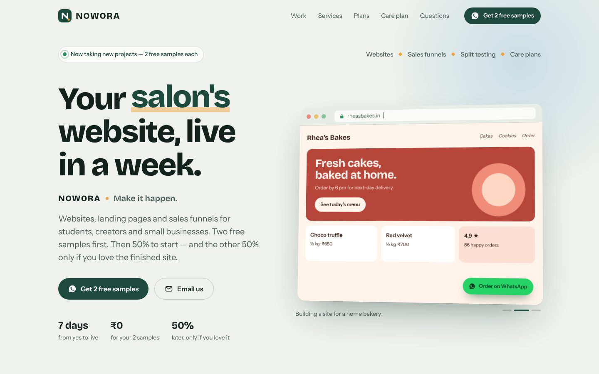
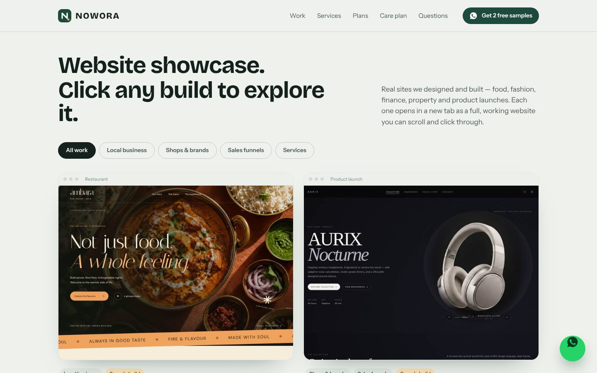
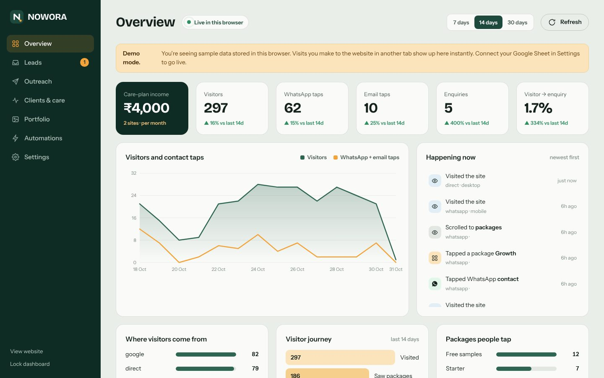
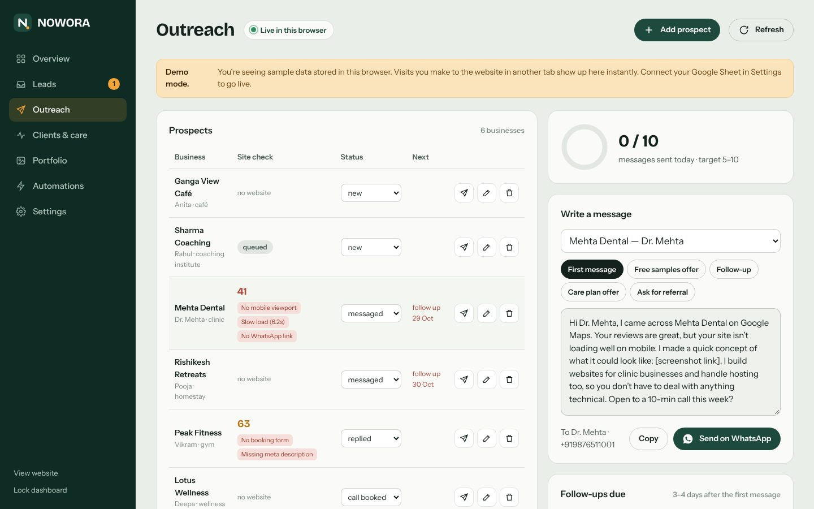

# NOWORA — Make it happen.

NOWORA is my web studio. I design and build websites, landing pages and sales funnels for students, creators and small businesses. Every client starts with two free samples, and the site goes live in about a week.

This repo is the whole studio system I built for it: the public website, a private owner dashboard, a Google Sheets backend, and Playwright automations that run on GitHub Actions.



## What's inside

| Part | What it does |
| --- | --- |
| **Website** (`site/index.html`) | Single-file site: live "site being built" hero animation, filterable showcase with hover-scroll previews, services, plans with an INR / USD toggle, care plan, scroll-pinned process, FAQ and an enquiry form that hands off to WhatsApp or email. No framework, no build step. |
| **Owner dashboard** (`site/index.html#admin`) | Live analytics (visitors, WhatsApp/email taps, enquiries, conversion, sources, visitor journey), a lead inbox, an outreach CRM with message templates and a daily target, client and care-plan tracking with onboarding checklists, portfolio uploads, automation health and 12-month goal tracking. |
| **Backend** (`apps-script/Code.gs`) | Google Apps Script web app on top of Google Sheets. Records events and enquiries, sends instant WhatsApp and email alerts, stores uploads in Google Drive, serves the dashboard behind an admin key, and emails a weekly review. |
| **Automations** (`scripts/`, `.github/workflows/`) | Playwright in GitHub Actions. **Uptime:** every 3 hours, opens each care-plan client site, checks it really renders and alerts on downtime. **Prospect audit:** every morning, scores a prospect's site on desktop and iPhone, lists issues worth fixing and saves a mobile screenshot for the pitch. |





## How it fits together

```
Visitor ──► Website ──(visits, taps, enquiries)──► Apps Script ──► Google Sheet
                                                       │
                                                       ├─► WhatsApp alert
                                                       └─► Email alert
Owner ──► Dashboard ◄──(live data every 15 s)──── Apps Script
GitHub Actions + Playwright ──(uptime + audit results)──► Apps Script
```

**Built with:** HTML, CSS and vanilla JavaScript · Google Apps Script · Google Sheets and Drive · Node.js · Playwright · GitHub Actions

## Privacy by design

The repo is public, so nothing private lives in it:
- Keys are stored in Apps Script properties and GitHub Secrets, never in code.
- Leads, clients and prospects live in a private Google Sheet.
- Automation logs only print counts. Site names, results and screenshots go straight to the private Sheet and Drive.

---

## Setup

### 1. Google Sheet backend

1. Open the Google Sheet, then **Extensions → Apps Script**. Paste `apps-script/Code.gs` and save.
2. Run `setup` once and approve permissions (**Advanced → Go to project → Allow**).
3. Copy `ADMIN_KEY` and `AUTOMATION_KEY` from the **Execution log**.
4. In **Project Settings → Script properties**, set `NOTIFY_EMAIL`, plus `CALLMEBOT_PHONE` and `CALLMEBOT_APIKEY` for WhatsApp alerts.
5. Go to **Deploy → New deployment → Web app**, set Execute as **Me** and Who has access **Anyone**. Copy the `/exec` URL.
6. Set `endpoint` at the top of `site/index.html` to that URL.

After editing Code.gs later, use **Deploy → Manage deployments → Edit → New version** so the URL stays the same.

### 2. WhatsApp alerts (CallMeBot)

Follow the WhatsApp API steps on callmebot.com to get a free API key for your own number. Then run `testAlerts` in Apps Script.

### 3. GitHub Actions

Under **Settings → Secrets and variables → Actions**, add:

| Secret | Value |
| --- | --- |
| `STUDIO_ENDPOINT` | the Apps Script `/exec` URL |
| `STUDIO_AUTOMATION_KEY` | the `AUTOMATION_KEY` |

Run each workflow once from the **Actions** tab to confirm.

Local test, which leaves the Sheet untouched:

```bash
npm install && npx playwright install chromium
TEST_SITES=https://example.com npm run test:audit
```

### 4. Dashboard

Open `yoursite/#admin` and sign in with `ADMIN_KEY`. Without a backend, it runs in demo mode with sample data stored in the browser.

---

© 2026 NOWORA. All rights reserved. This code is shared to show my work; it is not licensed for reuse.
